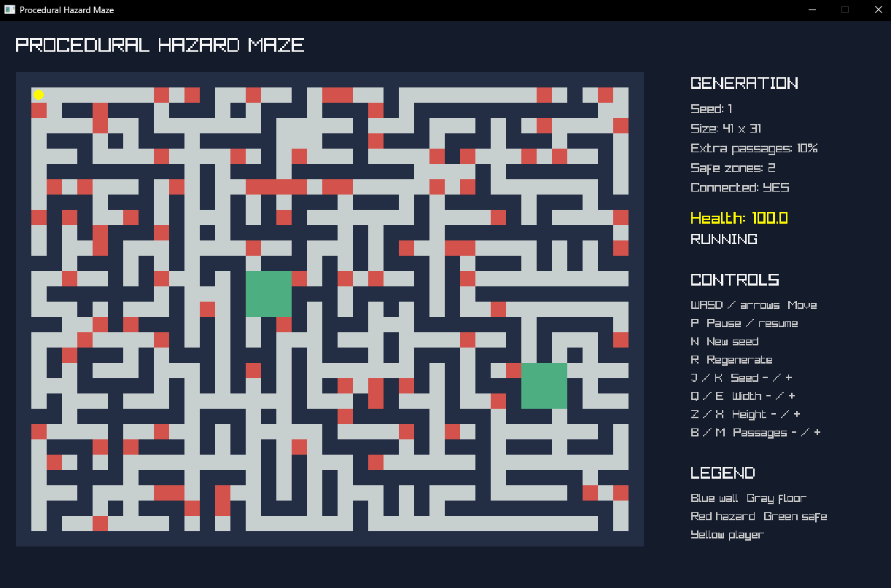

# procedural-hazard-maze

An independent C++20 gameplay programming portfolio project. It generates connected mazes, adds walkable safe zones and hazards, and lets a player explore them in a small raylib viewer. The project is independent of Unreal Engine and uses no external art assets.

## Preview



An interactive C++20 maze generator with safe zones,
hazards, player movement, and connectivity validation.

## Features

- Randomized Prim maze generation with a documented version 1 output contract.
- Manual and automatic rectangular safe zones. Disconnected floor regions are joined by passages chosen to remove as few walls as possible for each repair.
- Configurable additional passage probability, in whole percentages from 0 to 100.
- Separate hazard storage, player movement with wall collision, safe-zone immunity, health and damage over elapsed time.
- ASCII console demo, interactive raylib viewer, Catch2 tests and standalone benchmarks.

## Technologies

C++20, CMake and MSVC build the project. Catch2 v3 runs the functional tests through CTest. raylib v5.5 draws the viewer and reads keyboard input. GitHub Actions defines the Windows build and test workflow.

## Architecture

`maze_core` has no graphics dependency. `MazeConfig` validates generation settings. `MazeGrid` owns contiguous terrain cells (`Wall` or `Floor`). `generate_maze()` retains the original M1 algorithm; `generate_layout()` adds safe zones, connectivity repair and optional passages. `HazardLayer` owns a separate contiguous array. `Simulation` owns the layout, hazard layer, safe-cell lookup array and player state. The viewer handles input and drawing only.

Randomized Prim starts at `(1,1)`. It stores candidate rooms two cells away in a frontier, picks one at random, connects it to a carved room, and adds new candidates. A per-cell mark prevents duplicate frontier entries. This creates one connected, acyclic network of rooms and corridors. Terrain generation is O(width × height) time and space before optional repairs.

The version 1 path uses SplitMix64 and rejection sampling for bounded choices. The same seed and configuration produce the same layout across standard-library implementations. Tests pin the version 1 seed-42 snapshot. Extra generation uses a separate seed-derived random stream, so default settings leave that snapshot unchanged. Automatic safe-zone positions and hazards are deterministic too.

After carving safe zones, a breadth-first search finds floor cells disconnected from `(1,1)`. A 0-1 BFS then assigns cost zero to existing floor and cost one to a wall. It carves a minimum-wall path to one disconnected component and repeats until all floor cells connect. The repair chooses a minimum-wall path at each step; it does not claim a globally minimum set of walls across every component. At most 16 safe zones are allowed. Overlapping automatic zones are allowed and require no retry loop.

The simulation checks a player's grid cell for hazard exposure in O(1) time using contiguous hazard and safe-cell arrays. Damage is `10 health per second × elapsed seconds`, and pausing stops movement and damage. Movement uses small steps and tests the player's center against wall cells. It does not model a collision radius or continuous swept collision.

## Performance considerations

The grid, hazard layer, frontier marks and safe-cell lookup use contiguous arrays. Base generation and connectivity BFS are O(cells) in time and memory. A repair pass uses 0-1 BFS and is also O(cells); it may repeat for disconnected regions, up to the configured safe-zone count. Rendering visits visible grid cells once per frame, while player exposure checks only the player's current cell. Connectivity is recalculated when a maze is generated, not on every frame.

## Build on Windows

Install Visual Studio 2022 with the Desktop development with C++ workload and CMake 3.24 or newer. CMake downloads pinned source archives for Catch2 3.8.1 and raylib 5.5 and verifies their SHA-256 hashes. An internet connection is needed for the first configure. The Visual Studio generator builds x64 Debug and Release from one build directory.

```powershell
cmake --preset windows-debug
cmake --build --preset windows-debug --parallel 4
ctest --preset windows-debug
.\build\windows\Debug\maze_viewer.exe
.\build\windows\Debug\maze_demo.exe 21 11 42

cmake --build --preset windows-release --parallel 4
ctest --preset windows-release
.\build\windows\Release\maze_viewer.exe
.\build\windows\Release\maze_benchmarks.exe
```

Use `-DMAZE_BUILD_VIEWER=OFF`, `-DMAZE_BUILD_TESTS=OFF`, or `-DMAZE_BUILD_BENCHMARKS=OFF` when configuring to skip those targets. GitHub Actions builds and tests both configurations on `windows-2022`.

## Viewer controls

| Key | Action |
| --- | --- |
| WASD or arrow keys | Move player |
| P | Pause or resume |
| N | Generate a new seed |
| R | Regenerate with the current settings |
| J / K | Decrease / increase seed |
| Q / E | Decrease / increase width by two cells |
| Z / X | Decrease / increase height by two cells |
| B / M | Decrease / increase additional passages by 10 percentage points |

The viewer shows walls in blue, floors in gray, hazards in red, safe zones in green and the player in yellow. It also displays health, settings and connectivity status. Viewer dimensions are limited to odd values from 11 to 101 so the grid remains readable; the core accepts odd dimensions from 3 to 1023.

## Measured performance

These are local measurements, not performance guarantees. The standalone Release benchmark used an AMD Ryzen 7 5800X and MSVC 19.44 on Windows with a 101×101 maze, two automatic safe zones, 10% additional passages and seed 42 for the connectivity and hazard runs.

| Operation | Measured average |
| --- | ---: |
| Generate a layout, seeds 42–71, 30 runs | 0.324 ms per maze |
| Validate connectivity, 100 runs | 0.107 ms per BFS |
| Query all 10,201 hazard cells, 100 runs | 0.0131 ms per batch |

Run `maze_benchmarks.exe` on your machine for comparable local numbers. Benchmarks are not part of CTest.

## Known limitations

- The core limits dimensions to odd values from 3 to 1023 and up to 16 safe zones. These are project limits, not algorithmic requirements.
- The 64 MiB configuration check is a conservative storage guard, not a strict process-memory cap. Container overhead and temporary allocations are not included in that estimate.
- The dimension cap is checked before multiplication. With that cap, the overflow and memory-budget rejection branches cannot be reached on supported 64-bit Windows builds; tests cover the largest accepted size and reject dimensions above the cap.
- Hazard placement uses whole percentages and can put a hazard on the starting cell when that cell is not safe.
- The viewer supports one player, keyboard input and simple center-point collision. There is no save system, audio, pathfinding UI or advanced gameplay simulation.
